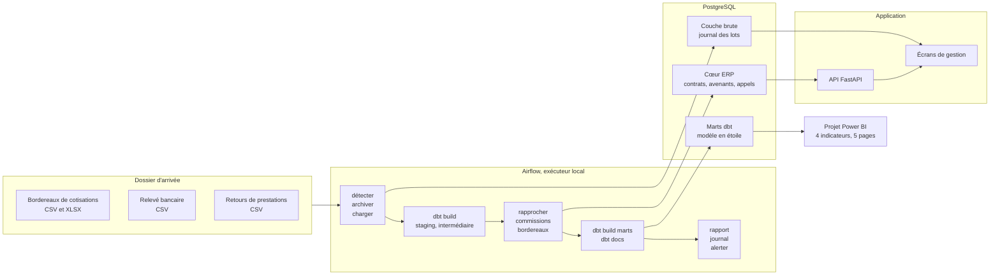

# courtage-erp

Un courtier grossiste délégataire reçoit chaque mois le bordereau de cotisations de ses compagnies, le
relevé de sa banque et le retour de prestations de son concentrateur de tiers payant. Il doit en tirer
trois choses avant de facturer quoi que ce soit : quelles cotisations appelées ont été encaissées,
combien les compagnies lui doivent de commission, et combien il reverse à chacun de ses apporteurs. Ce
dépôt est un mini-ERP qui fait ce travail, contrôles compris, sur un portefeuille simulé de 5 737
contrats et trois ans d'historique.

Données entièrement synthétiques, produites par le dépôt lui-même à graine fixe. Aucune donnée réelle,
aucun barème légal reproduit : chaque valeur métier est une hypothèse de simulation, listée dans
`docs/HYPOTHESES.md`.

## Architecture



Un lot rejeté par les contrôles ne laisse aucune ligne en base, et la tâche terminale `alerter` fait
échouer le graphe pour que le rejet se voie dans Airflow. Un second graphe, mensuel, construit les
variables de résiliation dans dbt puis écrit le score de chaque contrat en base (module 5). L'agent de
pré-remplissage du module 4a lit les documents reçus et dépose des dossiers que seul un gestionnaire peut
valider.

## Démarrage

```bash
docker compose up -d --build
```

La pile monte PostgreSQL, applique les migrations, génère le jeu de démonstration, dépose le courrier
simulé du mois, puis démarre l'application et Airflow. Deux adresses, sur la boucle locale seulement :

- l'ERP sur http://127.0.0.1:8000, avec sa documentation d'API sur `/api/doc` ;
- Airflow sur http://127.0.0.1:8080, compte `admin`, mot de passe `courtage`, à changer pour tout
  usage autre qu'une démonstration.

Pour dérouler la chaîne, activer le graphe `courtage_flux_financiers` dans Airflow et le déclencher.

Le même code tourne sans Docker, sur SQLite, ce qui est le chemin de développement rapide et celui d'un
relecteur qui n'a pas Docker :

```bash
make installer && make migrer && make generer && make servir
```

`make aide` liste les commandes. `make preuves` rejoue toutes les preuves du dépôt.

## Ce qui est livré

### Module 1, cœur ERP

Le problème : un contrat d'assurance change pendant sa vie, de formule, de tarif, d'apporteur, et un
gestionnaire doit pouvoir dire dans quel état il était à une date donnée, trois ans plus tard, parce que
c'est sur cet état que se calcule une commission ou se règle une prestation. La réponse retenue est
l'historisation par avenants : chaque événement crée une version, et l'état à une date se reconstitue en
relisant les avenants jusqu'à cette date. Le cache porté par la table `contrat` est comparé à cette
reconstitution par un contrôle de cohérence, de sorte que les deux ne peuvent pas diverger en silence.
Vingt-trois tables pour ce module, trente-trois avec celles des modules 2, 4a et 5, huit révisions de
migration qui montent et redescendent sans résidu, et des contraintes de vérification en base plutôt que dans le
seul code applicatif, parce qu'un ERP reçoit aussi des écritures par imports et par scripts de reprise. Le détail et la justification de chaque choix
sont dans `docs/modele-donnees.md`.

La délégation de gestion traverse tout le module, et c'est ce qui distingue un courtier délégataire d'un
courtier simple : le cabinet accomplit au nom de la compagnie des actes qui appartiennent normalement à
l'assureur, dans le périmètre d'une convention datée. Le jeu de démonstration contient une convention
arrivée à échéance et non renouvelée, pour que le refus soit constatable et pas seulement codé.

### Module 2, flux financiers

Le problème : le rapprochement entre ce qui a été appelé et ce qui a été encaissé se fait encore à la
main dans beaucoup de cabinets, il prend plusieurs jours par mois et il se trompe sur les lignes que
personne ne vérifie. La chaîne est orchestrée par Airflow en quatorze tâches, chacune appelant une
commande et lisant un code de retour, ce qui permet de la rejouer entièrement à la main sur un poste
sans Airflow.

Huit contrôles bloquants s'appliquent avant toute écriture : schéma et types, fichier déjà chargé par
son empreinte, doublon de clé métier, contrat ou adhérent inconnu, somme des lignes différente du total
déclaré, période incohérente avec la garantie, et acte non délégué. Un seul échec rejette le lot entier,
sans écriture partielle, et le fichier part dans le dossier des rejets avec son rapport d'anomalies, qui
est la pièce renvoyée à l'émetteur. Le rapprochement se fait d'abord par référence, puis par montant et
date dans une fenêtre paramétrable, et il conserve la méthode employée : une correspondance par montant
est une présomption, pas une certitude, et le gestionnaire qui instruit un litige doit savoir laquelle
il relit.

Les transformations dbt sont en couches, des sources aux marts, avec leurs tests et leur lineage. Les
commissions sont calculées au taux en vigueur à la date d'échéance de l'appel, pas au taux du jour,
faute de quoi une revalorisation du barème réécrirait des bordereaux déjà réglés.

### Module 3, pilotage

Le problème : un dirigeant lit quatre chiffres, le ratio de sinistres sur primes, le taux de résiliation,
la production par apporteur et le portefeuille par branche, et chacun se calcule de plusieurs façons qui
donnent des résultats différents. Sur ce jeu, le ratio de 2024 vaut 76,38 % rapporté aux cotisations
acquises des produits dont le cabinet règle les prestations, et 54,25 % si on le rapporte à tous les
produits, prévoyance comprise, qui n'a aucune prestation déléguée. `docs/kpi.md` définit chaque
indicateur une fois, chiffre ses pièges et renvoie à la requête SQL de contrôle.

Le choix technique est un modèle en étoile construit en dbt (cotisations acquises réparties au prorata des
jours, cliché de fin de mois du portefeuille, mouvements d'affaires nouvelles et de résiliations), lu par un
projet Power BI versionné en texte (format PBIP, modèle TMDL) avec 26 mesures commentées. La raison : une
mesure DAX qu'on ne peut pas comparer à une requête SQL est un chiffre qu'on croit sur parole. Le dépôt
compare donc 21 mesures sur 46 contextes, soit 302 comparaisons, et l'écart relatif maximal est de 2,9e-14.
Le tableau de bord est déclaré dans dbt comme une exposition, ce qui le rend visible dans le lineage.

Ce module a aussi mis au jour un défaut du jeu de données : le premier ratio de sinistres sur primes
dépassait 100 % sur toutes les périodes, parce que le générateur ne reliait pas les prestations aux
cotisations. Il a été corrigé le 22/10 (décision D32) et les chiffres du dépôt ont été remesurés. L'historique
complet est dans `docs/PROGRESS.md`.

### Module 4a, agent de pré-remplissage

Le problème : un gestionnaire ressaisit à la main les demandes de remboursement, les factures d'opticien,
les notes de dentiste et les attestations d'employeur qu'il reçoit. L'agent lit chaque document, en extrait
dix champs par un modèle de langage (Claude Haiku 5.5) contraint par un schéma JSON strict, les confronte
au portefeuille, puis dépose un dossier « à valider ». **Rien n'est écrit avant une décision humaine** :
valider un remboursement crée la prestation par le service de saisie existant, qui revérifie la
délégation, la garantie à la date des soins et le plafond. La base refuse elle-même une prestation
rattachée à un dossier non validé.

Mesuré sur 30 documents fictifs : 96,7 % des champs exacts, 100 % sur les identifiants, les dates et les
montants ; les dix écarts portent tous sur l'émetteur des demandes, lu « Cabinet Grossiste Delegataire -
Service prestations » quand la vérité terrain n'attend que le nom du cabinet. Les contrôles relèvent les 8
anomalies volontaires (nom mal orthographié, adhérent inexistant, total faux, soins avant l'effet du
contrat) et ne bloquent aucun document sain. Coût moyen : 0,00027 $ par document, latence moyenne
1,8 seconde. Chaque réponse réelle est enregistrée : l'évaluation et les tests se rejouent sans clé
d'API, et refusent une réponse devenue périmée. Détail dans `docs/eval-extraction.md`.

### Module 5, prédiction de résiliation

Le problème : au 1er janvier, jour de l'échéance et de la revalorisation, quels contrats vont partir dans
l'année ? C'est le moment où le cabinet peut encore appeler l'adhérent ou revoir la formule.

Les variables sont construites dans dbt à chaque 1er du mois, sans lire un seul avenant postérieur à la
date d'observation, et un test dbt le revérifie à chaque construction. Apprentissage sur 2023 et 2024, test
sur 2025, la dernière année dont les douze mois sont entièrement observés. Sur l'année de test, la
régression logistique atteint une ROC-AUC de 0,645 et un lift de 2,22 sur le premier décile ; la formule
qui a réellement servi à générer les résiliations, recalculée sur les mêmes contrats, plafonne à 0,662.
LightGBM, prévu comme modèle plus performant, ne fait mieux sur aucune mesure : c'est donc la régression
logistique qui est déployée. Ses quatre variables les plus influentes sont exactement les quatre causes
écrites dans le générateur, dans le bon sens.

Chaque mois, le graphe `courtage_scoring_resiliation` écrit la probabilité, le décile et les trois facteurs
qui poussent le risque à la hausse, affichés sur la fiche adhérent en phrases de gestionnaire. **Les données
sont synthétiques** : l'intérêt est la démarche (absence de fuite, validation dans le temps, choix du modèle
simple quand le complexe ne fait pas mieux, explications lisibles), pas la performance. Détail et calibration
dans `docs/eval-resiliation.md`.

### Module 6, documentation et présentation

Ce dépôt, `docs/DEMO.md` (le parcours de deux minutes) et `docs/POUR-LA-DIRECTION.md` (la correspondance
entre chaque module livré et un besoin d'éditeur de logiciel de courtage). La page de présentation vit dans
le portfolio, pas ici.

### Preuves

Chaque chiffre publié dans la documentation vient d'un fichier de `results/`, produit par une exécution
réelle. L'intégration continue rejoue l'ensemble sur SQLite et sur PostgreSQL, et monte la pile Docker.

| Preuve | Résultat | Fichier |
| --- | --- | --- |
| Migrations qui montent et redescendent | 8 révisions, 33 tables, aucun résidu, sur SQLite et PostgreSQL | `results/migrations_sqlite.json` |
| Génération reproductible | même graine, même empreinte, sur les deux moteurs | `results/reproductibilite_sqlite.json` |
| Cohérence métier des données | 18 contrôles, tous conformes | `results/coherence_metier.json` |
| La base refuse les écritures interdites | 5 insertions SQL directes sur 5 refusées | `results/contraintes_sqlite.json` |
| Les tests détectent les défauts qu'ils couvrent | 9 défauts réintroduits, 9 détectés | `results/mutation.json` |
| Suite de tests | 255 passés, 13 sautés | `results/pytest.txt` |
| Détection des anomalies injectées | contrôles bloquants : 9 sur 9 trouvées, aucun faux positif ; avertissements : rappel 0,908 et précision 0,649 | `results/flux_rapport_detection.json` |
| Journal d'exécution par lot | 27 lots, 9 rejetés | `results/flux_journal_lots.json` |
| Alerte sur lot rejeté | code de retour 1 sur les 9 rejets du jeu | `results/flux_alerte_rejets.json` |
| Transformations dbt | 52 modèles, 151 tests, 3 expositions : 199 réussites, 4 avertissements, 0 erreur | `results/dbt_build.txt` |
| Mesures Power BI contre le SQL | 302 comparaisons, écart relatif maximal 2,9e-14 | `results/concordance_dax_sql.csv` |
| Indicateurs de pilotage | ratio sinistres sur primes de 76,38 % en 2024 et 79,99 % en 2025 | `results/kpi_sql.json` |

## Ce qui n'est pas fait

- **Module 4b, recherche dans les conditions générales : non réalisé.** Ni conditions générales
  fictives, ni recherche, ni questions de test.

## Limites assumées

- **Le portefeuille est simulé.** Les signaux qu'il contient, saisonnalité des soins, hausses tarifaires
  au 1er janvier, résiliations liées à l'ancienneté et au tarif, sont ceux qu'un générateur y a mis. Ce
  qui se démontre ici est la mécanique, pas la réalité d'un marché.
- **Le bordereau de commissions reçu de la compagnie n'est pas ingéré.** Quand la compagnie encaisse
  elle-même, le cabinet est commissionné sur la base du bordereau qu'elle lui adresse ; faute de ce
  quatrième flux, le calcul retient la cotisation appelée hors taxe, qui est la meilleure assiette
  observable. Ces lignes sont comptées à part pour rester rapprochables. Voir `docs/DECISIONS.md`, D24
  et D25.
- **Le bordereau de prestations émis vers la compagnie n'est pas modélisé.** Le module traite les flux
  entrants, là où se posent le contrôle et le rejet. Voir D22 et D23.
- **Une police collective n'a pas d'avenants.** L'apporteur d'une police est celui enregistré sur elle,
  sans historisation, à la différence d'un contrat individuel.
- **Le domaine des énumérations n'est pas tenu par la base.** Il l'est par la validation applicative,
  pour une raison de portabilité expliquée dans `docs/modele-donnees.md`.
- **Le remboursement santé est simplifié.** Le taux de la garantie s'applique aux frais présentés : la
  base de remboursement de l'assurance maladie et la part du régime obligatoire ne sont pas modélisées.
  Voir `docs/HYPOTHESES.md`, section Prestations.
- **Le module 4b n'est pas fait** : recherche dans les conditions générales. Voir « Ce qui n'est pas fait ».
- **L'agent de pré-remplissage lit des PDF produits par le dépôt**, au texte net. Un scan ou une photo
  demanderait une reconnaissance de caractères, que le dépôt n'a pas : un document sans texte est refusé
  explicitement.
- **La sinistralité individuelle n'est pas une cause de résiliation dans le jeu**, bien que les paramètres
  du générateur la prévoient : elle n'est pas appliquée, et le module 5 ne l'emploie pas. Voir
  `docs/HYPOTHESES.md` et la décision D35.
- **L'intégration continue n'exécute pas dbt**, qui demande PostgreSQL et la chaîne de flux. Un défaut de
  règle de commission est resté invisible pour cette raison jusqu'au premier `dbt build` complet.
- **Le projet Power BI porte un chemin d'exemple** vers les données : après un clone, il faut le régénérer
  avec `make pbip DONNEES=...`. Les CSV (18 Mo) ne sont pas versionnés, et les captures viennent d'un seul
  poste.
- **Le portefeuille n'a pas de ratio lisible avant 2024** : le quittancement simulé commence le 01/10/2023.
- **Ni automobile ni dommages** : le jeu couvre la santé individuelle, la santé collective et la prévoyance.
  Les taux, formules et périmètres sont des données paramétrables par produit, mais aucune autre branche n'a
  été modélisée ni testée.

## Où regarder

| Fichier | Contenu |
| --- | --- |
| `docs/DEMO.md` | le parcours de deux minutes, écran par écran |
| `docs/POUR-LA-DIRECTION.md` | chaque module livré, relié à un besoin de gestion |
| `docs/kpi.md` | définition des quatre indicateurs et leurs pièges chiffrés |
| `docs/eval-extraction.md` | agent de pré-remplissage : précision par champ, anomalies relevées, coût et latence |
| `docs/eval-resiliation.md` | prédiction de résiliation : découpage, mesures, calibration, causes retrouvées |
| `docs/PROGRESS.md` | état réel, preuve par preuve, et comment reprendre |
| `docs/flux-financiers.md` | la chaîne du module 2, étape par étape |
| `docs/modele-donnees.md` | diagramme entité-association et justification de chaque choix |
| `docs/DECISIONS.md` | une ligne par choix technique, avec l'alternative écartée |
| `docs/HYPOTHESES.md` | toute valeur métier simulée, marquée comme hypothèse |
| `docs/lessons/` | ce que le projet a appris en se trompant |
| `results/` | sorties des exécutions réelles, source de tout chiffre publié |

## Licence

MIT, voir `LICENSE`.
